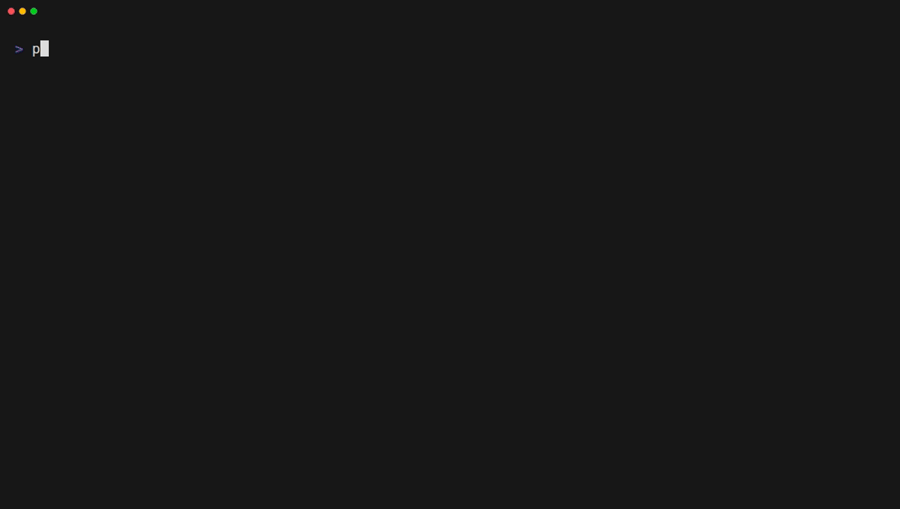

# procnetmon

[](https://github.com/DaCatBeam/procnetmon/actions/workflows/ci.yml) [](https://ratatui.rs/)

Live terminal charts for Linux network interfaces, read straight from `/proc/net/dev`.

procnetmon shows how much traffic each interface is moving right now, how that has trended over the last few minutes, and whether anything is erroring or dropping packets. It's for people who look after Linux machines and want that answer in a terminal, over SSH or inside a container, without installing an agent or running as root. It's built in Rust with [ratatui](https://ratatui.rs) and crossterm.

- **Four charts:** throughput for one interface, an overview of every interface, session totals, and errors and drops.
- **Readable numbers:** byte rates and totals in binary units (KiB/s, MiB/s, GiB), on a throughput scale that fits the traffic on screen.
- **Real-world interface names:** Docker bridges (`br-3f2a1b4c5d6e`), VLANs (`eth0.100`), and overlay devices (`flannel.1`) all show up. Interfaces that appear mid-session are picked up, and the charts mark ones that disappear as gone.
- **Correct under counter resets:** when a counter goes backwards because an interface was re-created or its driver reset, it's treated as a reset rather than drawn as a negative spike.
- **Light:** one thread that reuses its buffers between samples, with memory bounded by the chart window (about 40 KB per interface at the defaults).

| Chart | What it shows |
|---|---|
| Throughput (default) | Receive and transmit bytes per second for the selected interface, over the window. |
| Overview | One row per interface, with its current rx and tx rates and a sparkline of each. |
| Session totals | Bytes and packets each interface has moved since the app started, or since it appeared. |
| Errors & drops | Errors, drops, FIFO errors, and collisions per second for each interface, averaged over the window, plus the share of frames with errors, color-coded. |

## Demo


## Requirements

- Linux, to read live counters from `/proc/net/dev`. Elsewhere, such as on macOS, it can read a saved capture with `--file`.
- Rust 1.99 or newer, to build it. That's the version it's built and tested with, and older ones may work too. There are no prebuilt binaries yet.

## Installation

### With Cargo, from GitHub

```sh
# Install Rust first if you don't have it: https://rustup.rs
curl --proto '=https' --tlsv1.2 -sSf https://sh.rustup.rs | sh

cargo install --git https://github.com/DaCatBeam/procnetmon
```

### From source

```sh
git clone https://github.com/DaCatBeam/procnetmon
cd procnetmon
cargo build --release
./target/release/procnetmon
```

## Usage

```sh
procnetmon                                     # sample every second, chart the last 5 minutes
procnetmon -p 250 --window 60                  # sample 4 times a second, chart the last minute
procnetmon --file capture.txt                  # read a saved capture instead of /proc/net/dev
RUST_LOG=debug procnetmon --log-file /tmp/procnetmon.log
```

To make a capture on any Linux machine, run `cat /proc/net/dev > capture.txt`. The app re-reads the file on every tick, so writing a newer capture over it moves the charts.

## Options, keys and configuration

### Options

| Option | Description | Default |
|---|---|---|
| `-p, --poll-interval <MS>` | Time between samples, in milliseconds (50–60000). | `1000` |
| `-w, --window <SECS>` | How much history the charts show, in seconds (10–86400). | `300` |
| `-f, --file <PATH>` | Counters file to read. Point it at a capture to run anywhere. | `/proc/net/dev` |
| `-l, --log-file <PATH>` | Append logs to `PATH`. Nothing is logged without it. | off |
| `-h, --help` | Print help. | |
| `-V, --version` | Print the version. | |

### Keys

| Key | Action |
|---|---|
| `↓` or `j` | Next item in the focused pane |
| `↑` or `k` | Previous item in the focused pane |
| `→` or `Tab` | Focus the next pane |
| `←` or `Shift+Tab` | Focus the previous pane |
| `q`, `Esc`, or `Ctrl+C` | Quit |

The sidebar holds two panes: the list of interfaces on top and the list of charts below. The focused pane has a cyan border, and the selected chart fills the rest of the screen. The bottom line lists the keys, dropping whole entries when the terminal is too narrow.

### Configuration

There's no config file. Two environment variables change what gets logged and reported:

| Variable | What it sets | Default |
|---|---|---|
| `RUST_LOG` | Which log lines `--log-file` gets, as [tracing directives](https://docs.rs/tracing-subscriber/latest/tracing_subscriber/filter/struct.EnvFilter.html#directives) such as `debug` or `proc_net_dev=trace`. | `info` |
| `RUST_BACKTRACE` | Set to `1` to add a backtrace to the report printed when the app stops on an error or a panic. | off |

## Limitations

- **Linux only.** The data comes from procfs. Use `--file` with a capture to run it anywhere else.
- **Containers see their own interfaces.** Inside a container, `/proc/net/dev` lists only the container's interfaces, usually `lo` and `eth0`. Run it with `--network host` on a Linux host to see the host's.
- **Resets under-report one interval.** The sample that spans a counter reset loses whatever traffic arrived before the reset, and 32-bit counter wraps on older drivers are treated as resets.
- **Only the window is kept.** Samples older than the chart window are dropped. Session totals aren't affected.
- **Gone interfaces stay listed.** An interface that disappears, such as a stopped container's veth, is dimmed in the charts, but it stays in the sidebar and the charts until the app exits.
- **Errors while running only reach the log.** A failed read or a malformed line is logged with `--log-file`, but nothing on screen shows it yet.
- **Signals skip the terminal cleanup.** Quitting with a key, an error, or a panic restores the terminal, but `SIGTERM` or `SIGHUP` don't. Run `reset` if that leaves your terminal in a bad state.

## Roadmap

See [ROADMAP.md](ROADMAP.md).

## Developing

See [DEVELOPERS.md](DEVELOPERS.md).

## Contributions

To contribute, open a pull request against `main` that meets the [PR standards](DEVELOPERS.md#pr-standards) in DEVELOPERS.md.

## License
See [LICENSE](LICENSE).
